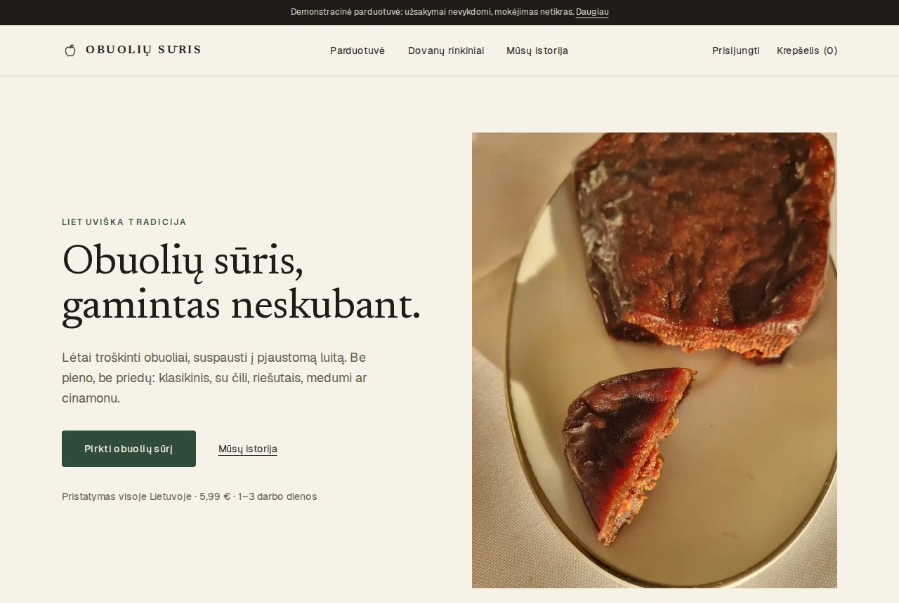
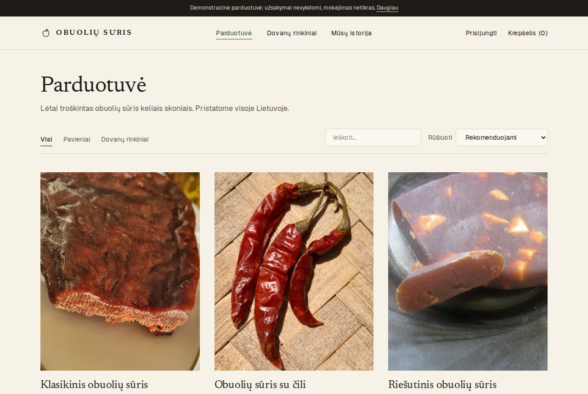
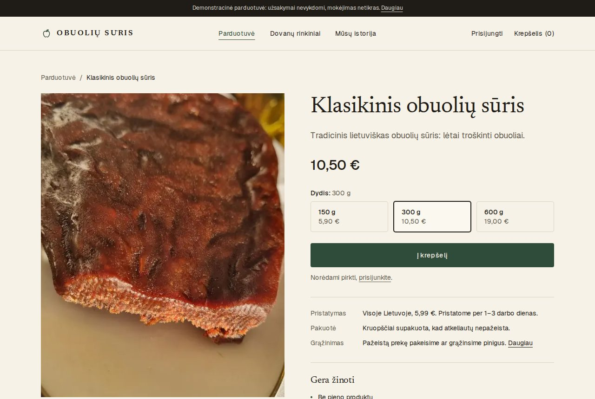
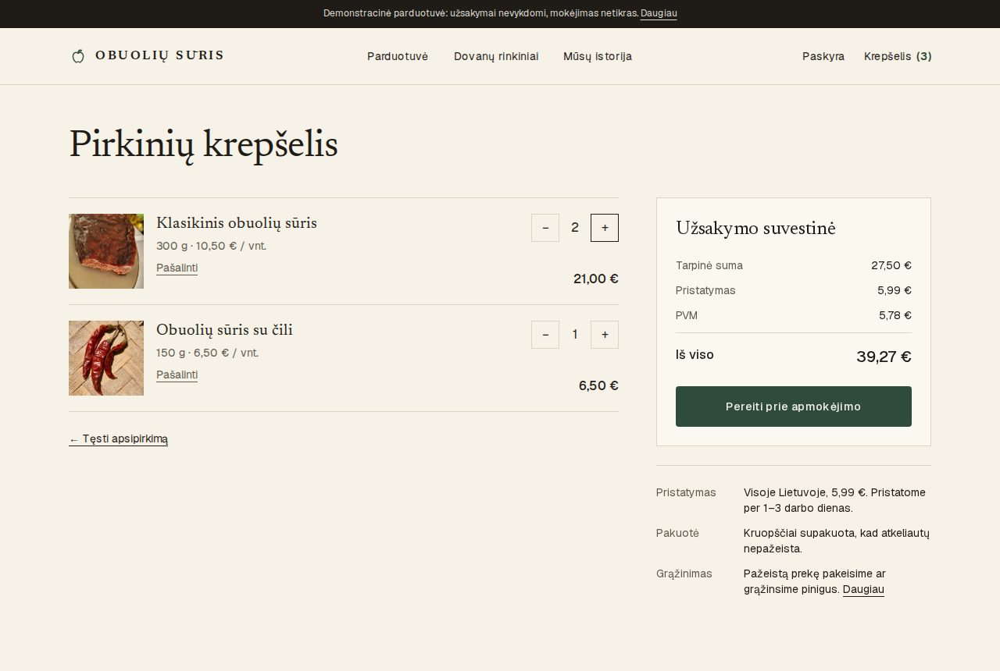
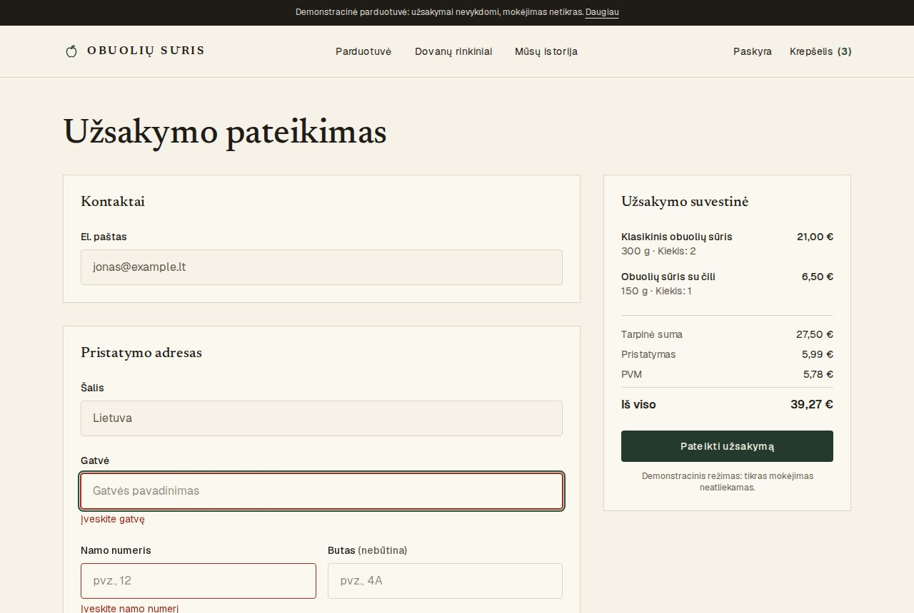
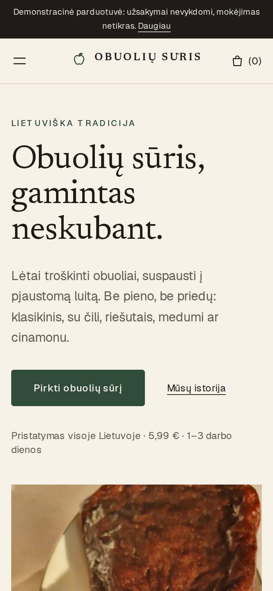
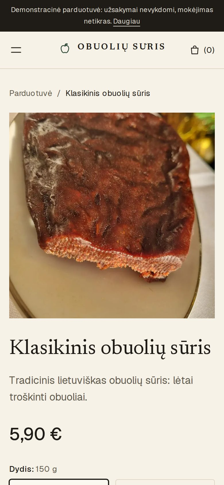
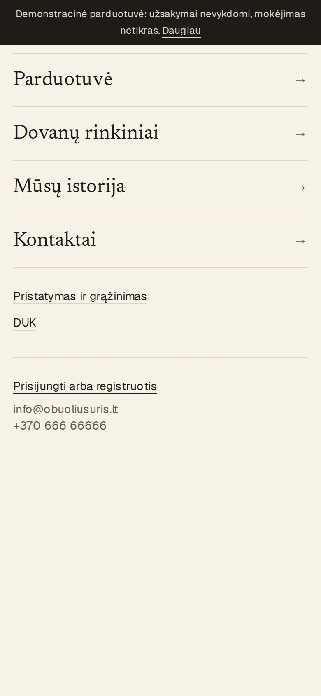

# Obuolių sūris: storefront

A full-stack e-commerce portfolio project: an online shop for **obuolių sūris** ("apple cheese"), a traditional Lithuanian confection of slow-cooked apples pressed into a sliceable block. Despite the name it contains no dairy. The shop sells it in several flavours (classic, chilli, nuts, honey, cinnamon) and in several sizes, plus a tasting gift box.

This folder is the **Next.js storefront**. The REST API lives next to it in [`../api`](../api).

> **This is a demonstration shop.** Payment is simulated and no orders are fulfilled. The interface is Lithuanian only, because it is designed for the Lithuanian market.

[](https://github.com/tadasdukavicius/apple-cheese/actions/workflows/web.yml)

**Try it:** clone the repository and run both apps locally; see [Getting started](#getting-started). The screenshots below show what it looks like.

## Screenshots

| Home | Catalogue |
| --- | --- |
|  |  |
| **Product with size selection** | **Cart** |
|  |  |

| Checkout validation | Mobile home | Mobile product | Mobile menu |
| --- | --- | --- | --- |
|  |  |  |  |

The screenshots are generated by `npm run screenshots`. The interface is in Lithuanian: *Parduotuvė* = shop, *Krepšelis* = cart, *Į krepšelį* = add to cart, *Pristatymas* = delivery.

## Features

- **Catalogue:** server-rendered product list with search, category filter and sort. Prices are shown as "from" the cheapest size.
- **Product pages:** size selector with a live price, delivery and returns summary, per-product page titles and social previews.
- **Cart:** persistent per-user cart with optimistic quantity updates (rolled back if the request fails), item count in the header, and a retry state when loading fails.
- **Checkout:** validated address and phone form (react-hook-form + zod), order summary with shipping and VAT, order confirmation page and order history.
- **Accounts:** email and password sign-up and sign-in with Supabase Auth, protected pages that return you to where you were, and Lithuanian translations of the common auth errors.
- **Contact form:** validated, with a honeypot field, posting to a rate-limited API endpoint.
- **Content pages:** story, delivery and returns, FAQ, image credits.
- **SEO and sharing:** `sitemap.xml`, `robots.txt`, generated Open Graph image, `noindex` on private pages.
- **Accessibility:** skip link, visible focus styles, labelled form controls with linked error messages, `aria-current` navigation, respects `prefers-reduced-motion`.
- **Design:** warm ivory and ink palette with one forest-green accent, Newsreader (serif) for headings and Geist for text, with a mobile-first layout (checked at 375px and desktop widths).

## Tech stack

| Area | Choice |
| --- | --- |
| Framework | Next.js 16 (App Router), React 19 |
| Language | TypeScript |
| Styling | Tailwind CSS 4 with design tokens in `app/globals.css` |
| Forms and validation | react-hook-form, zod |
| Auth and database client | Supabase (`@supabase/supabase-js`) |
| Backend | [Express API](../api) |
| Fonts | Newsreader and Geist via `next/font` (with the `latin-ext` subset for Lithuanian letters) |

## Architecture

```
Browser ──► Next.js storefront ──► Express API ──► Supabase (Postgres + RLS)
   │         (server-rendered         (validation,        ▲
   │          catalogue pages)         pricing, orders)   │
   └───────────── sign-in / sign-up (Supabase Auth) ──────┘
```

- Catalogue pages are rendered on the server by calling the API. The home page is revalidated every 60 seconds.
- Sign-in happens directly against Supabase Auth in the browser. The resulting access token is sent to the API as a bearer token for cart and order requests.
- The API never trusts amounts from the client. Totals are calculated in the database from current prices. The storefront only displays them.

## Getting started

### Prerequisites

- Node.js 20 or newer
- A free [Supabase](https://supabase.com) project
- The API running locally (see its README), which also contains the SQL for the database

### 1. Set up the backend

Follow the setup steps in the [API README](../api/README.md): run `supabase/schema.sql` and `supabase/seed.sql` in your Supabase project, configure its `.env`, and start it with `npm run dev` (it listens on port 8008).

### 2. Configure the storefront

```bash
cp .env.example .env
```

Fill in the values from your Supabase project (**Project Settings → API**).

### 3. Run it

```bash
npm install
npm run dev        # http://localhost:3000
```

In Supabase, under **Authentication → Providers → Email**, you can turn off "Confirm email" while developing, so new accounts can sign in immediately.

## Environment variables

| Variable | Required | Description |
| --- | --- | --- |
| `NEXT_PUBLIC_API_URL` | yes | Base URL of the API **including** `/api/` and the trailing slash, e.g. `http://localhost:8008/api/` |
| `NEXT_PUBLIC_SUPABASE_URL` | yes | Your Supabase project URL |
| `NEXT_PUBLIC_SUPABASE_ANON_KEY` | yes | The public (anon or publishable) key. It is safe to expose because row-level security protects the data |
| `NEXT_PUBLIC_SITE_URL` | no | Public URL of the site, used for the sitemap and social previews. Defaults to `http://localhost:3000` |

Never put the Supabase **service-role / secret** key in this project. It belongs only in the API.

Missing or malformed settings fail fast with a message naming the variable (see `lib/config.ts`). The API URL works with or without a trailing slash.

## Scripts

| Command | What it does |
| --- | --- |
| `npm run dev` | Development server |
| `npm run build` | Production build |
| `npm start` | Serve the production build |
| `npm run lint` | ESLint |
| `npm run typecheck` | TypeScript, no emit |
| `npm test` | Unit and component tests (Vitest) |
| `npm run test:e2e` | End-to-end and accessibility tests (Playwright) |
| `npm run screenshots` | Regenerate the README screenshots |

## Testing

| Layer | Tooling | What is covered |
| --- | --- | --- |
| Unit and component | Vitest, Testing Library | Price and date formatting, totals, validation schemas and their Lithuanian messages, auth error translation, safe redirects, env config, the size selector (price and variant follow the chosen size, keyboard use), product card, contact form |
| End to end | Playwright | Browse, filter, sort and search; size selection; sign in, sign up, sign out and redirects; adding to cart; quantity changes and removal; checkout validation; placing and paying an order; order history; contact form; FAQ; the mobile menu; no horizontal scrolling on key pages; a cart that fails to load |
| Accessibility | axe-core via Playwright | WCAG 2.1 A and AA on every public page, the signed-in cart and checkout, the validation-error state and the mobile menu |

The end-to-end tests run the real production build against a small in-memory stand-in for the API and Supabase Auth (`tests/e2e/mock-api.mjs`), so they are fast and need no accounts. They do **not** prove the real database behaves the same way: that is covered by the API's own SQL tests. Playwright builds into `.next-e2e`, so it never touches a running dev server.

```bash
npm test
npx playwright install chromium   # once
npm run test:e2e
```

Writing these tests found real problems that are now fixed: a product thumbnail link with no accessible name, low-contrast read-only form fields, and signing out of a private page landing on the sign-in screen instead of the home page.

## Continuous integration

[`.github/workflows/web.yml`](../.github/workflows/web.yml) runs on every push and pull request: lint, type-check, unit tests and a production build; the Playwright suite (with the HTML report uploaded on failure); and `npm audit` for production dependencies. Dependabot proposes updates weekly.

## Project structure

```
app/            Routes (App Router): home, products, cart, checkout, orders, account, info pages
components/     UI building blocks (Navigation, Footer, ProductCard, ProductPurchase, forms, ...)
context/        Auth, cart and toast providers
hooks/          useRequireAuth (redirects signed-out users to /login)
lib/            API client, env config, price/date formatting, validation schemas, pricing helpers, site constants
types/          Shared TypeScript types for products, cart items and orders
public/images/  Product and hero photographs
tests/unit/     Vitest unit and component tests
tests/e2e/      Playwright tests, the mock backend, helpers and the screenshot generator
docs/           README screenshots
```

## Design decisions

- **Server-rendered catalogue, client-side cart.** Product pages are fetched on the server for fast first paint and good link previews. Cart and checkout are client components because they depend on the signed-in user.
- **One API client** (`lib/api.ts`) with a typed error class, so every page handles failures the same way, including network errors.
- **Cart state is keyed to the access token**, so a different or signed-out user can never briefly see a previous user's cart.
- **Security headers.** `next.config.ts` sets `nosniff`, a referrer policy, frame denial and a permissions policy, and in production a Content-Security-Policy that only allows the API and Supabase origins taken from the build environment. Scripts still need `'unsafe-inline'` because Next injects inline scripts; a nonce-based policy would be the next step.
- **Design tokens, not one-off colours.** Colours, fonts and common component classes (`btn-primary`, `input`, `card`) are defined once in `app/globals.css`.

## Known limitations

This is a portfolio project, and these are deliberate or known gaps:

- **Payment is simulated.** The API has a payment-provider interface and a fake provider that always succeeds. No real payment provider is integrated.
- **End-to-end tests use a mock backend,** not a real Supabase project. They cover the storefront's behaviour, not the integration with the live database.
- **No forgot-password flow,** and no account deletion.
- **Sample content.** Contact details, delivery times, FAQ answers and the returns policy are placeholders and should be replaced before any real use.
- **VAT is added on top of the subtotal** at 21%. In practice, EU consumer prices usually include VAT.
- **Lithuania only, flat shipping.** There is one shipping rate and one destination country. There is no stock tracking, discount codes, order cancellation or admin area, and no order emails.
- **The cart needs an account.** Guests cannot add items.
- **Lithuanian only.** There is no language switcher.
- **A missing product shows the 404 page but responds with HTTP 200.** This is a side effect of streaming a route that has a loading state.
- **Some product photos are placeholders:** the classic, nuts and gift-box photos show real apple cheese, while the chilli, honey and cinnamon photos show the ingredients.

## Image credits

Photographs come from Wikimedia Commons under Creative Commons licences. Authors and licences are listed on the in-app [credits page](app/credits/page.tsx) (data in `lib/imageCredits.json`).
